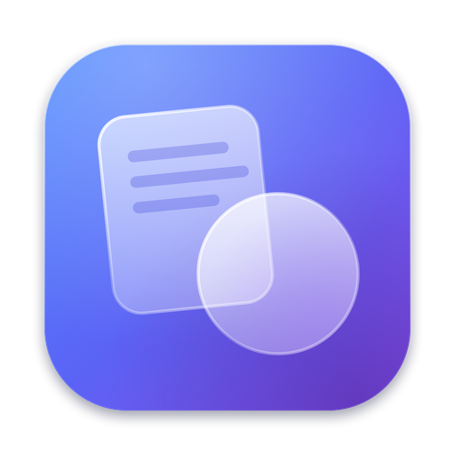
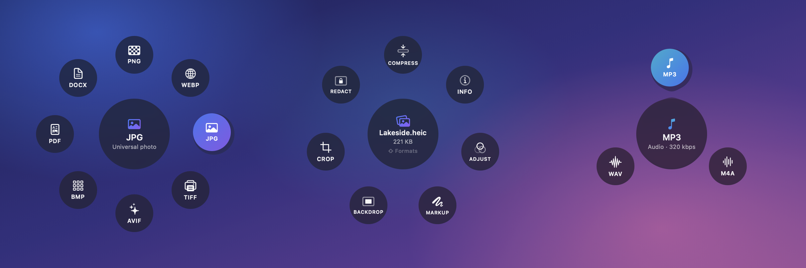
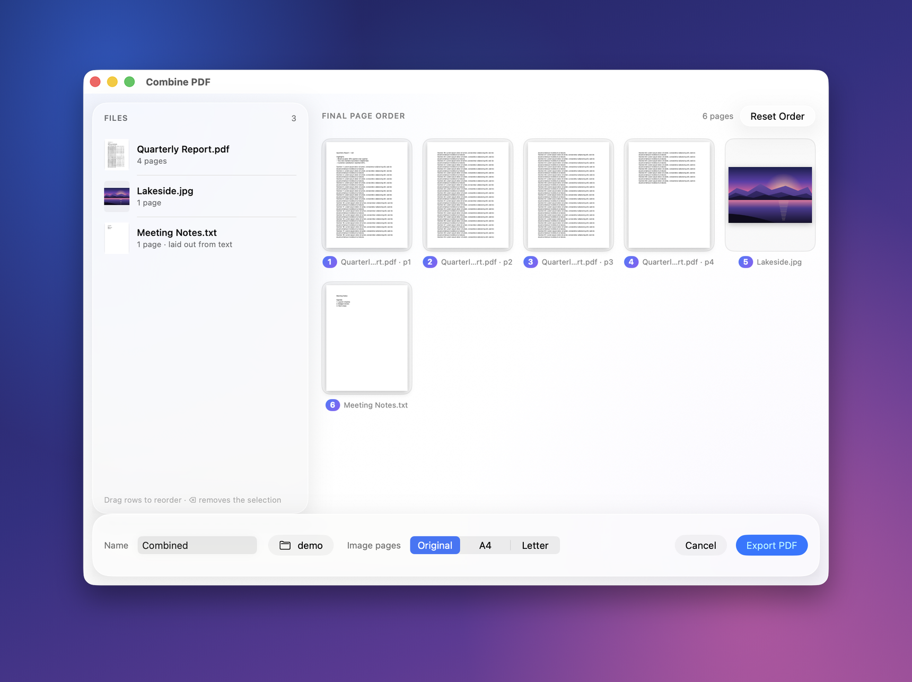
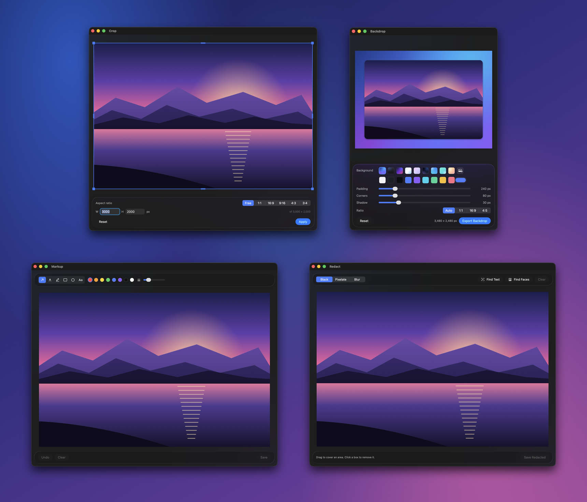
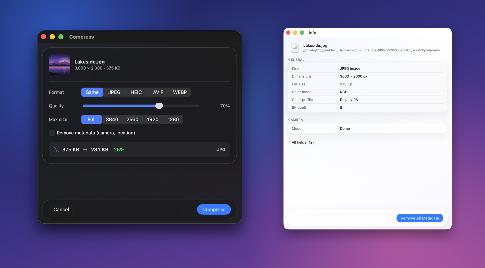
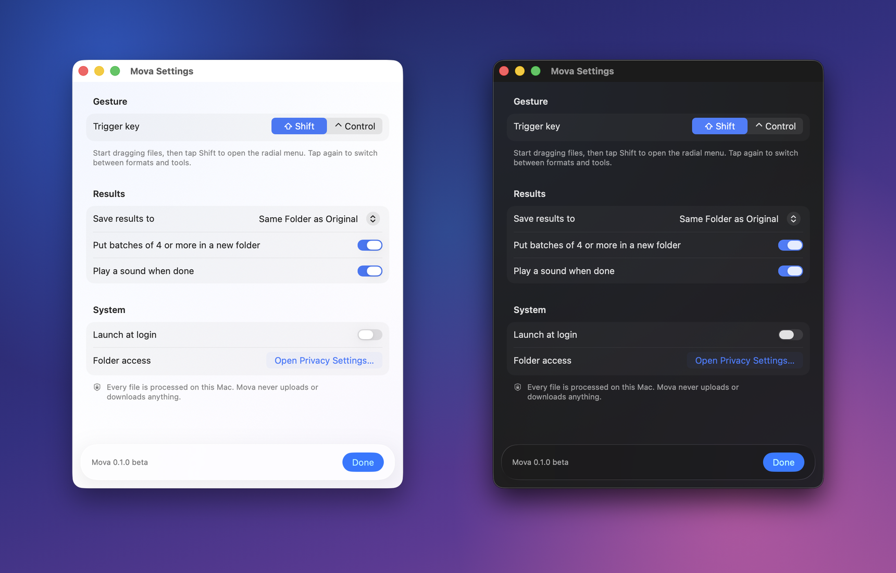

# Mova

**Drag. Tap ⇧. Transform.**

Convert and edit files in the middle of a drag, on your Mac, for free.

---

## How it works

1. **Start dragging** a file (or several) from Finder or your desktop.
2. **Tap Shift** while you're still holding it. A glass *radial menu* opens around the cursor with what fits those files.
3. **Drop on a bubble.** The result appears next to the original. Tap Shift again mid-drag to switch from formats to tools.

There's nothing to open and no window to manage. Mova lives in your menu bar.

## Features

| | |
|---|---|
| 🔁 **Convert** | Images, PDFs, documents, video and audio, with one drop |
| 🎵 **Video → MP3** | Pull the soundtrack out of MP4, MOV, MKV and more as 320 kbps MP3, M4A or WAV |
| 📑 **Combine into one PDF** | Drop photos, PDFs and documents together, reorder pages in a preview, export a single PDF |
| ✂️ **Quick edits** | Crop, adjust light and color, mark up, add a backdrop, redact, compress, inspect or strip metadata |
| 🛡️ **Originals are never touched** | Results get new names (`Photo.jpg` → `Photo.png`, `Combined 2.pdf`); nothing is overwritten |
| 🔒 **Private by design** | No account, no upload, no tracking. Everything runs on your Mac |
| 🫧 **Liquid Glass** | Native Liquid Glass on macOS 26 Tahoe, translucent materials on 14–15. Follows light and dark mode, Reduce Motion and Reduce Transparency |

## Supported formats

| Drag in | Get out (first ⇧) | Tools (second ⇧) |
|---|---|---|
| **Images**: JPG, PNG, HEIC, WEBP, TIFF, AVIF, BMP, GIF, RAW… | JPG, PNG, WEBP, HEIC, TIFF, AVIF, BMP, PDF, DOCX | Compress · Info · Adjust · Markup · Backdrop · Crop · Redact |
| **PDF** | DOCX, JPG, PNG, TXT (with on-device text recognition for scans) | Compress · Info · Rotate · Split |
| **Documents**: TXT, Markdown, RTF, HTML, DOCX, ODT | PDF, DOCX, RTF, TXT, HTML, ODT | — |
| **Video**: MP4, MOV, MKV, M4V, WEBM, AVI… | MP3 (320 kbps), M4A, WAV | — |
| **Audio**: WAV, M4A, FLAC, MP3, AIFF, OGG… | MP3, M4A, WAV | — |
| **Several images / PDFs / documents** | **Combine** → one PDF | — |

HEIC and AVIF output appear only on Macs whose macOS can write them.

## Screenshots

  

  

  

  

  

## Install

1. **[Download `Mova-v0.1.0-beta.dmg`](https://github.com/matthewap2007-cell/mova/releases)** from Releases.
2. Open it and **drag Mova onto Applications**.

   

3. Open Mova from Applications. Because this free beta isn't notarized by Apple yet, macOS asks you to confirm once:
   - **macOS 15 Sequoia and later:** macOS says it couldn't verify Mova. Click **Done**, then open
     **System Settings → Privacy & Security**, scroll down to *“Mova” was blocked…*, click **Open Anyway** and confirm.
   - **macOS 14 Sonoma:** Control-click Mova in Applications, choose **Open**, then click **Open**.
4. The Mova icon appears in the menu bar and a short guide opens.
5. The first time you convert a file in Desktop, Documents or Downloads, macOS asks whether Mova may open files there. Click **Allow**.

A step-by-step guide with pictures of each dialog is in [docs/INSTALL.md](docs/INSTALL.md). No Terminal and no Homebrew are needed: everything Mova uses is inside the app.

## Privacy

Mova never uploads, syncs or tracks anything.
- **No network connections**: conversions run on your Mac, and the bundled FFmpeg helper is built without networking.
- **No accounts, analytics or ads.**
- **Only the files you drop** are read. Results are written next to them (or to Downloads or Desktop, if you choose).
- **Settings stay on this Mac**: your preferences and the list of recent results are kept in macOS's standard preferences.

Full details: [PRIVACY.md](PRIVACY.md).

## Requirements

- macOS 14 Sonoma or later
- Any Mac with Apple silicon or an Intel processor (universal app)
- About 27 MB of disk space (15 MB download)

## Known limitations (beta)

- **Not notarized yet**, so macOS shows a one-time warning on first launch (see *Install*).
- **Drags that carry no real file** don't open the radial menu; use *Open Files…* in the menu instead. This includes drags straight out of Photos, Mail attachments and some browsers.
- **PDF → DOCX** brings over text, not layout. Scanned pages are added as images.
- **Animated GIF and multi-page TIFF** inputs use the first frame or page.
- **Video → audio** extracts the first audio track only.
- **Editors work on the first file** of a multi-file drop; Compress handles all of them.
- **One drag-to-convert app at a time**: if a similar app also listens for Shift during drags, both will open.
- **Liquid Glass needs macOS 26.** On macOS 14 and 15 the same design uses the system's translucent materials.
- **Tested on Apple silicon.** The Intel version is verified under Rosetta 2, not yet on a physical Intel Mac.

## Reporting a bug

- **In Mova:** menu bar icon → **Help & Feedback → Report a Bug…** opens a pre-filled form here on GitHub. It includes your macOS and Mova versions, never your files.
- **Or directly:** [open an issue](https://github.com/matthewap2007-cell/mova/issues/new/choose). Add the steps, the file type, and what you expected. *Copy Diagnostics* in the same menu gives you the version details to paste.
- **Security problems:** please follow [SECURITY.md](SECURITY.md) instead of filing a public issue.

## License

Mova is **free to download and use** (see [LICENSE.md](LICENSE.md)). The app's source code isn't public.

Mova bundles **FFmpeg** and **LAME** (LGPL) and **libwebp** (BSD-3-Clause). Their licenses and complete source code are published with every release; see [THIRD_PARTY_NOTICES.md](THIRD_PARTY_NOTICES.md).

## Changelog

See [CHANGELOG.md](CHANGELOG.md).

---

Apple, Mac, macOS and Finder are trademarks of Apple Inc., registered in the U.S. and other countries. Mova is an
independent project and is not affiliated with or endorsed by Apple. FFmpeg is a trademark of Fabrice Bellard.
