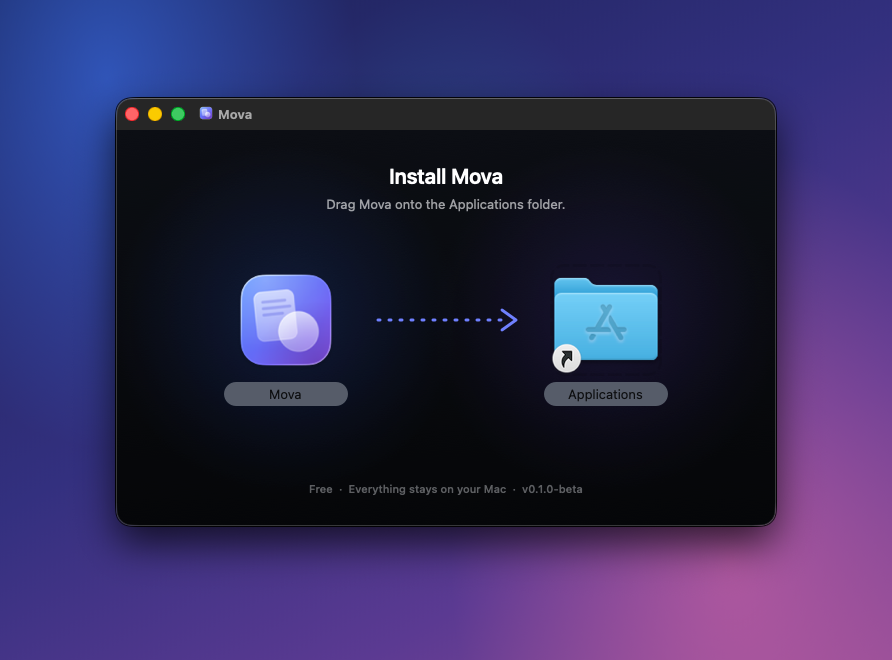

# Installing Mova

No Terminal, no Homebrew, no account. About two minutes.

## 1. Download
Get **`Mova-v0.1.0-beta.dmg`** (15 MB) from the [Releases page](https://github.com/matthewap2007-cell/mova/releases).

## 2. Drag it into Applications
Double-click the downloaded file. A window opens. **Drag the Mova icon onto the Applications folder.**

When the copy finishes, eject the disk image: click the ⏏ next to “Mova” in a Finder sidebar, or drag it to the Trash.

> Run Mova from **Applications**, not from inside the disk image or your Downloads folder. If you open it from the disk image, Mova asks you to move it first.

## 3. Open it for the first time
This beta isn't notarized by Apple yet (that needs a paid Apple developer account), so macOS asks you to confirm it once.

**macOS 15 Sequoia and macOS 26 Tahoe**
1. Open **Applications** and double-click **Mova**.
2. macOS says it can't verify that “Mova” is free of malware. Click **Done**. Don't move it to the Trash.
3. Open  **→ System Settings → Privacy & Security** and scroll down to **Security**.
4. Next to *“Mova” was blocked to protect your Mac*, click **Open Anyway**, then confirm with your password or Touch ID.
5. Click **Open** in the last dialog.

**macOS 14 Sonoma**
1. Open **Applications**, **Control-click** (or right-click) **Mova**, and choose **Open**.
2. Click **Open** in the dialog.

You only do this once. From then on Mova opens normally.

## 4. Start using it
- The Mova icon (a page with a circle) appears in the **menu bar**, and a short *How Mova Works* guide opens.
- Try it: start dragging a photo on your desktop, **tap Shift** while still holding it, and drop it on **PNG**.
- The first time you convert something in **Desktop, Documents or Downloads**, macOS asks whether Mova may open files there. Click **Allow**. If you clicked *Don't Allow* by mistake, use the menu bar icon → **Folder Access Settings…** and turn the folder on for Mova.

## Optional
- **Start at login:** menu bar icon → **Launch at Login**.
- **Save results somewhere else:** menu bar icon → **Save Results To**.
- **Use Control instead of Shift:** menu bar icon → **Trigger Key**.

## Updating
Download the new disk image and drag Mova into Applications again, choosing **Replace**. Your settings are kept.

## Uninstalling
1. Menu bar icon → **Quit Mova**.
2. Drag **Mova** from Applications to the Trash.
3. Optional: delete its preferences at `~/Library/Preferences/io.github.matthewap2007-cell.Mova.plist`.

## Checking the download (optional)
Every release lists SHA-256 checksums in `SHA256SUMS.txt`. If you're comfortable with Terminal, run
`shasum -a 256 ~/Downloads/Mova-v0.1.0-beta.dmg` and compare the result with that file.

## Trouble?
- *Nothing happens when I tap Shift:* make sure you're dragging an actual file (not text or a photo straight out of the Photos app), and that only one drag-to-convert app is running. Or use **Open Files…** in the menu.
- *“Allow Mova to open Downloads”:* see step 4 above.
- Anything else: [report a bug](https://github.com/matthewap2007-cell/mova/issues/new/choose).
